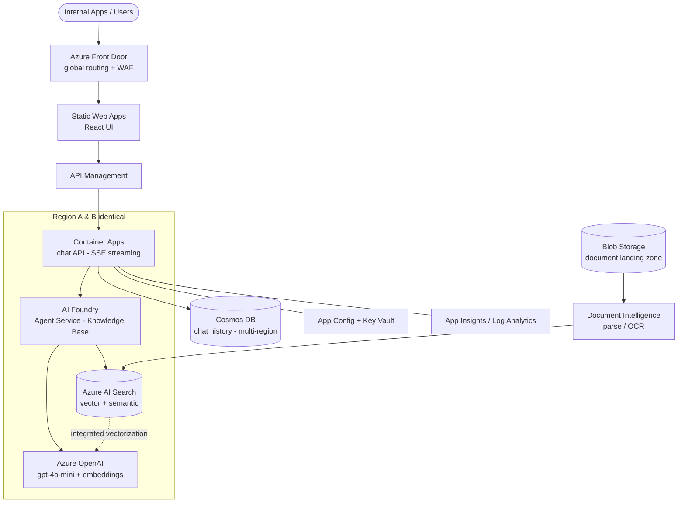

# 1. Target architecture (full)

## Two core flows

### 1. Ingestion (indexing documents)

Drop docs in **Blob Storage** → **Document Intelligence** parses complex PDFs/tables →
**AI Search indexer + skillset** chunks and calls the embedding model (integrated
vectorization) → vectors land in the index. Replaces the entire custom Solr + embedding
pipeline; runs on a schedule or on blob events.

### 2. Query (knowledge base answer)

UI → APIM → Container Apps → **Foundry Agent** grounded on the AI Search index → agent
retrieves (hybrid + semantic rerank), calls **gpt-4o-mini**, streams the answer back over
**SSE** with citations. Chat history persists to **Cosmos DB**. No queues, no WebSocket
connection-routing layer.

## What can be deleted outright

Output Chunks Queue, priority/standard + precise/summary queues, WebSocket
connection-mapping logic, Solr, the Java conversation engine, AWS Parameter Store, and
Splunk. Most of that becomes platform configuration.

See diagrams:
- [`diagrams/target-architecture.mmd`](diagrams/target-architecture.mmd)
- [`diagrams/ingestion-flow.mmd`](diagrams/ingestion-flow.mmd)
- [`diagrams/resilient-multiregion.mmd`](diagrams/resilient-multiregion.mmd)
