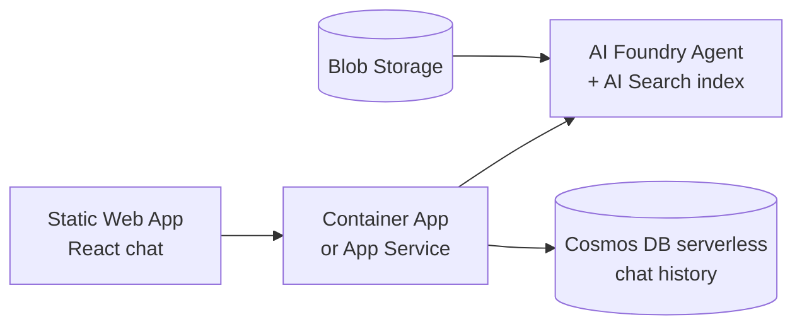

# 3. Minimal viable stack (test scalability & cost)

You can prove out scalability and cost with a **3-service MVP** — everything else is additive.

## The "almost no code" path

1. **Create a project** in AI Foundry.
2. **Add your data** — point it at a Blob container; Foundry's *"Add your data"* wizard
   provisions an **AI Search** index with integrated vectorization automatically.
3. **Deploy `gpt-4o-mini` + an embedding model** (Global Standard).
4. **Test in the playground**, then **"Deploy as a web app"** or use the REST/SDK endpoint.

## Cheap, consumption-based tiers for testing

| Service | Test tier | Cost behavior |
|---|---|---|
| Container Apps | Consumption | Scale-to-zero, pay per request/vCPU-sec |
| AI Search | **Basic** (or Free to start) | Fixed low monthly; bump replicas/partitions to load-test scale |
| Azure OpenAI | Global Standard (PAYG) | Pay per token — main cost driver |
| Cosmos DB | **Serverless** | Pay per RU, no min |
| Blob + Static Web App | Standard / Free | Negligible |
| App Insights | Pay-as-you-go | Negligible at test volume |

## Measuring scalability + cost

- **Cost:** tag everything with one tag (e.g. `project=askmaya-mvp`), watch **Cost
  Analysis** filtered by that tag. Token usage shows per-deployment in AOAI metrics.
- **Token cost is ~everything** — log prompt/completion tokens per request to App Insights
  and multiply by the model rate to predict the bill at scale.
- **Load test:** Azure Load Testing against the API; watch Container Apps replica count and
  AI Search latency/throttling (429s) to find where to add replicas/partitions/AOAI capacity.

## One template, every environment

Use **`azd up`** with the repo's [`azure.yaml`](../azure.yaml) + [`infra/main.bicep`](../infra/main.bicep).
Parameterize tier sizes per environment so dev runs cheap (serverless/scale-to-zero) and the
same template scales up for a load test.

## Suggested order

1. Portal-only: Foundry + "Add your data" → playground works.
2. `azd` it: Container App API + Static Web App + Cosmos serverless.
3. Load test one region, read the cost-per-1k-questions number.
4. Only then decide if Front Door / multi-region / Private Endpoints are needed.
