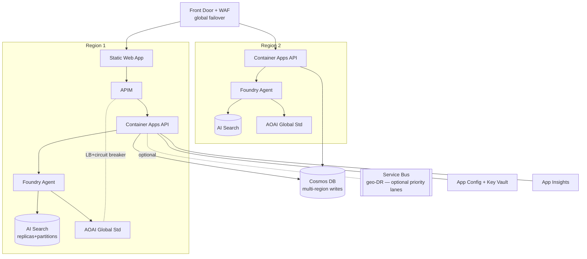

# 4. Feature-parity matrix (nothing lost when simplifying)

| # | Current feature | New resilient equivalent | Resiliency mechanism |
|---|---|---|---|
| 1 | React UI (`askmaya-app`) | **Static Web Apps** (React) | Global CDN, auto-failover, staging slots |
| 2 | Java backend (`askmayaweb-api`) | **Container Apps** API (stateless) | KEDA autoscale, multi-replica, scale-to-zero, revisions |
| 3 | Conversation Logic (`askmaya-api`) | **AI Foundry Agent Service** | Managed orchestration, retries, grounding |
| 4 | Solr9 vector DB + embeddings | **Azure AI Search** (vector + integrated vectorization) | Replicas (query HA) + partitions (scale); zone-redundant |
| 5 | `embedding-api` | **AOAI embedding model** (Search skillset) | Global Standard deployment, platform failover |
| 6 | `ranking-api` / semantic ranking | **AI Search semantic ranker** (L2 reranking) | Native feature, no service to run |
| 7 | `industry-classifier-api` | **Agent tool / classifier prompt** or small AOAI call | Stateless, retried by agent runtime |
| 8 | `askmaya-qpl-api` (query rewrite) | **Agent query rewriting** (built into retrieval) | Managed by Foundry |
| 9 | `search-askmaya-api` | **AI Search query** (hybrid + semantic) | Built-in backoff, HA replicas |
| 10 | OpenAI via **APIM** | **APIM** in front of AOAI pool | LB across regional AOAI, circuit breaker, retry policy |
| 11 | Precise vs Summary mode | **Agent prompt/parameter profiles** (two system prompts/temps) | Config in App Configuration |
| 12 | Priority vs Standard queues | **APIM rate-limit tiers** + Service Bus *(only if async kept)* | Service Bus zone-redundant, geo-DR; or drop |
| 13 | `max_waiting_minutes`, queue_status | **APIM concurrency/quota policies** + Container Apps queue-depth autoscale | Platform backpressure |
| 14 | Output Chunks Queue + Queue Processor | **SSE streaming** straight from API/agent | Eliminated — fewer moving parts |
| 15 | WebSocket API + connection routing | **SSE** (or **Azure SignalR** for fan-out) | SignalR multi-region, managed connection state |
| 16 | `trace_id` / `connection_id` | **App Insights trace/operation IDs** + session id | Native distributed tracing |
| 17 | Long polling & message removal | **Not needed** (streaming + agent run lifecycle) | Removed complexity |
| 18 | Send progress updates | **SSE token stream / agent run status events** | Built-in |
| 19 | Redis Cache | **Azure Cache for Redis** (Premium = zone-redundant) *(optional)* | Geo-replication; or fold into Cosmos |
| 20 | PostgreSQL `chat_history`, `chat_control` | **Cosmos DB** (multi-region) | Multi-region writes, 99.999% SLA, auto-failover |
| 21 | GET History Endpoints (Panel, Conversation) | **API routes over Cosmos** | Same endpoints, resilient store |
| 22 | AWS Parameter Store (concurrency, weights, calibrations) | **App Configuration + Key Vault** | Geo-replicated, Managed Identity, no secrets in code |
| 23 | Splunk logging | **App Insights / Log Analytics** | Native, token-usage + eval dashboards |
| — | (new) Document ingestion | **Blob + Document Intelligence + Search indexer** | Event-driven, retryable, idempotent |

## The one real decision: do you still need queues?

- **Streaming (Output Chunks Queue + WebSocket routing)** → replaced by **SSE**. Simpler
  *and* more resilient. ✅ Drop it.
- **Priority access (Priority vs Standard)** → two options:
  - **Simplest:** APIM products/rate-limit tiers — priority users get higher quota,
    requests stay synchronous. No queue. Best for the MVP.
  - **If you truly need async buffering under burst:** keep **one** **Azure Service Bus**
    (zone-redundant, geo-DR) with two queues, and let Container Apps autoscale on queue
    depth (KEDA). Preserves exact priority/standard semantics on a managed broker.

## Resilient architecture (multi-region)

## Resiliency checklist by tier

- **Global:** Front Door health probes → automatic regional failover.
- **Compute:** Container Apps min-replicas ≥ 2 in prod, zone-redundant, revision rollout.
- **Search:** ≥ 2 replicas (query HA) + partitions for scale; rebuild index from Blob (source
  of truth) for DR.
- **Models:** APIM pool spreads load across regional AOAI + retry/circuit-breaker → no
  hand-rolled round-robin.
- **Data:** Cosmos multi-region (and Redis Premium geo if kept).
- **Config/secrets:** App Config + Key Vault, Managed Identity — geo-replicated, secretless.
- **Ingestion:** Blob is durable source of truth; indexer retries; reindex = full recovery.

**Net result:** every feature preserved; three things removed because they become unnecessary
(Output Chunks Queue, WebSocket connection-routing, long-polling); priority semantics survive
via APIM tiers (or one managed Service Bus). More resiliency than today because failover,
autoscale, and load-balancing move from app code into the platform.
