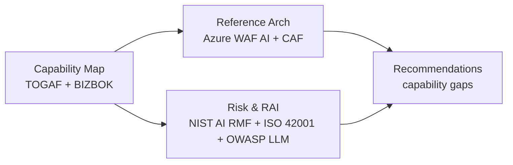

# 6. One-week in-depth review — outcomes & framing

Staffed review of the Ask Maya application. Key outcomes:

1. **Anonymized customer examples** of similar applications — described at the **capability**
   level so they can be compared/anonymized without exposing products. Ideally architectures
   with a "capabilities" layer on top to stay agnostic.
2. **Full capability-aligned architecture** for building "Ask Maya" ourselves — grounded on
   the Azure/Microsoft stack but extrapolated to an agnostic capability view.
3. **Specific capability change/addition recommendations** for the Ask Maya application.

- **Outcome 1:** describe each customer at the **BIZBOK capability** level.
- **Outcome 2:** structure with **TOGAF capability-based planning + ArchiMate**, validate
  against **Azure WAF AI workloads** + the **baseline OpenAI chat reference**.
- **Outcome 3:** score current Ask Maya against **NIST AI RMF**, **OWASP LLM Top 10**, and
  the **WAF 5 pillars**; each gap becomes a recommendation.

## Suggested daily milestones (one-week plan)

| Day | Focus | Artifact |
|---|---|---|
| 1 | Discovery — current architecture walk-through, capability extraction | Draft L1/L2 capability map |
| 2 | Anonymized customer comparators at capability level (Outcome 1) | Comparator pack |
| 3 | Reference architecture mapping (Azure WAF AI + CAF + baseline chat) | Capability → reference arch |
| 4 | Risk & RAI scoring (NIST AI RMF, OWASP LLM Top 10, WAF pillars) | Scorecard |
| 5 | Gap analysis → recommendations (Outcome 3), readout | Recommendations deck |
