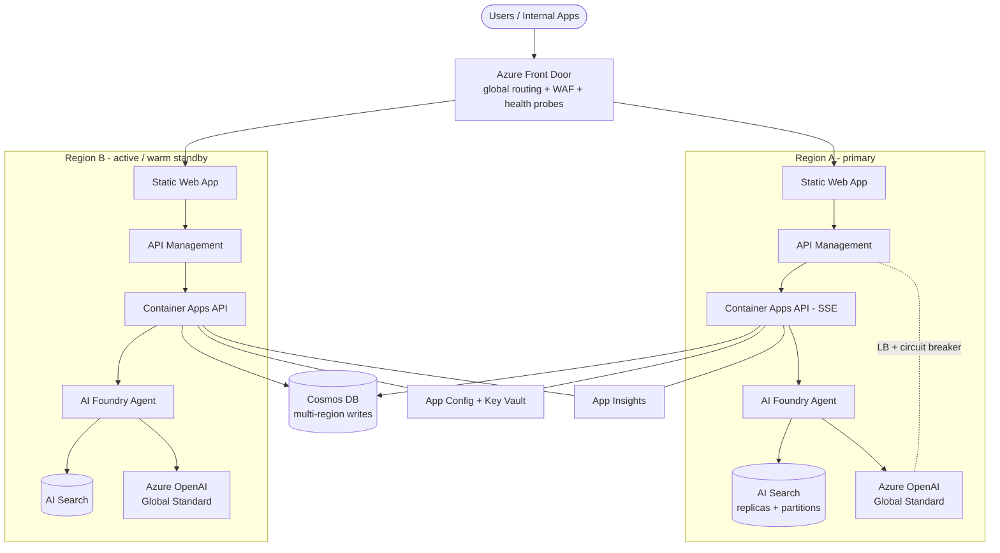
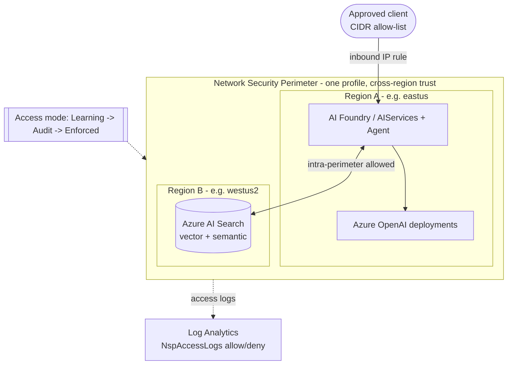
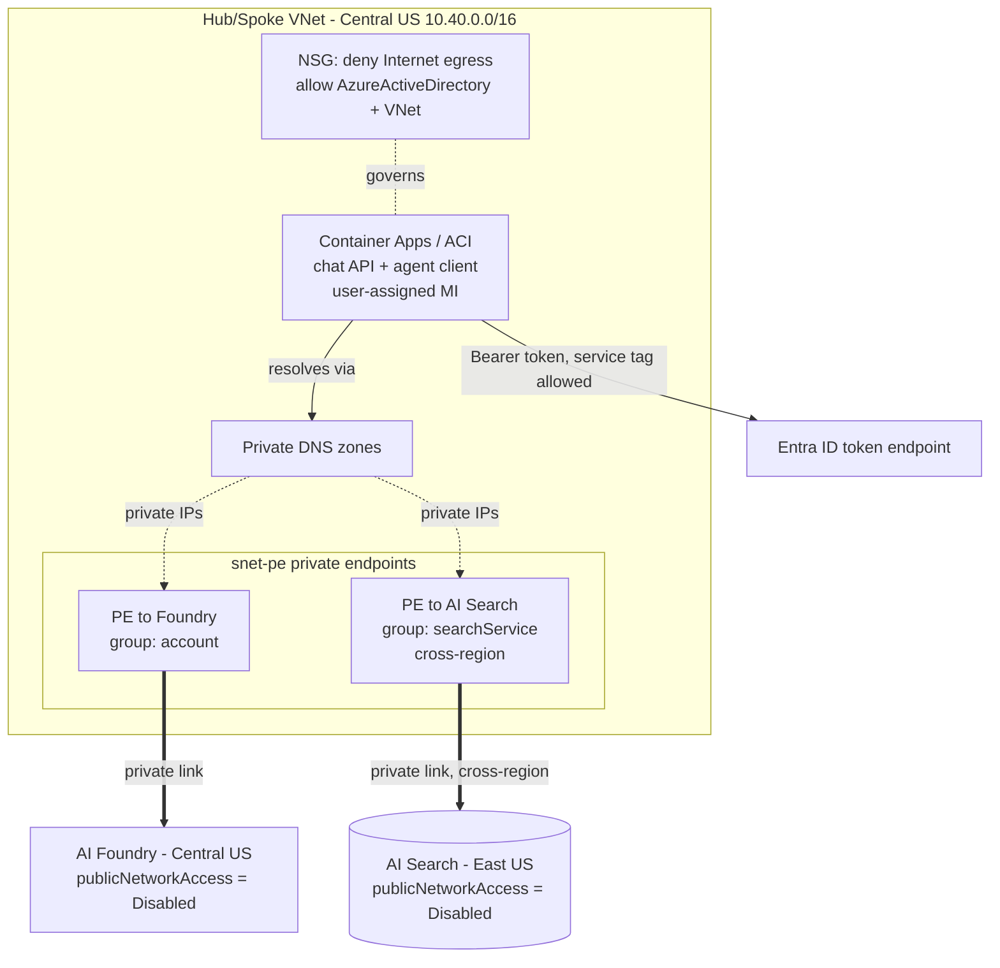
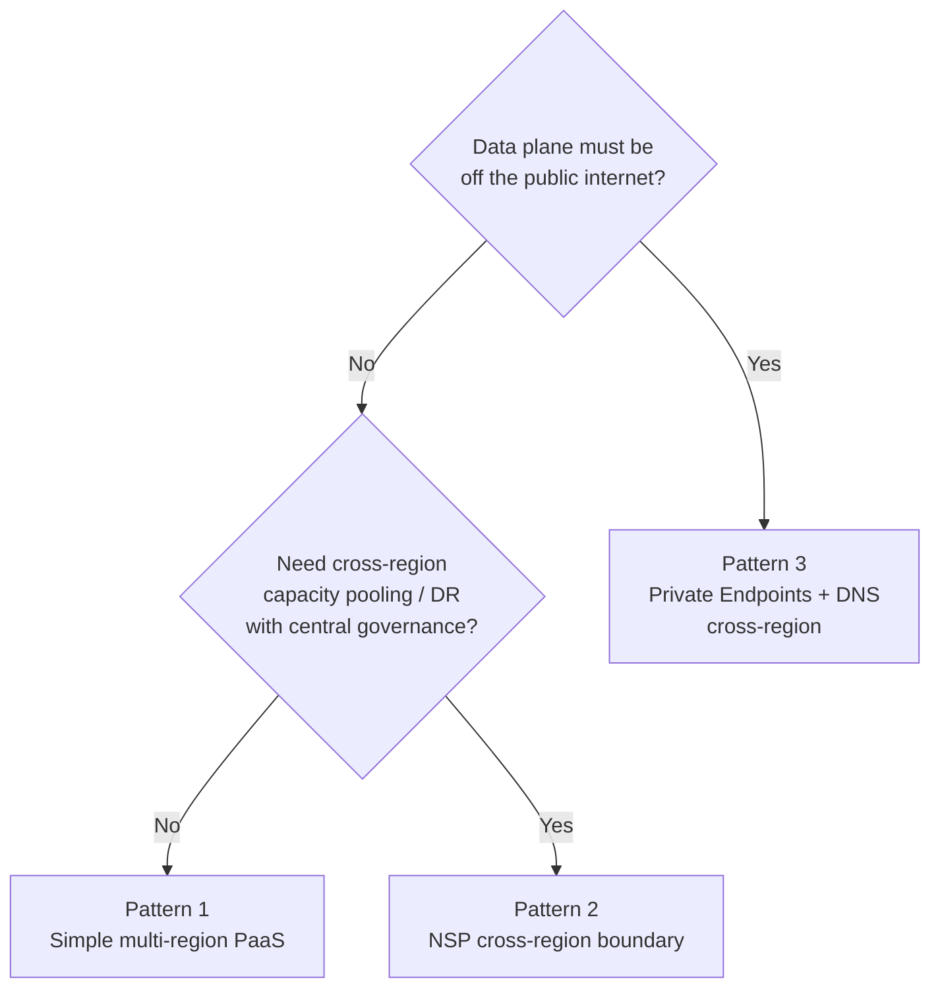

# 10. Architecture patterns & guidance

Three reference patterns for the Ask Maya RAG knowledge base, ordered from simplest to most
network-isolated. Each pattern lists when to use it, the architecture, resiliency/DR
characteristics, networking posture, trade-offs, and the infra template in this repo that
implements it.

| # | Pattern | Network posture | Primary problem it solves | Infra template |
|---|---|---|---|---|
| 1 | Simple, scalable multi-region chat app | Public PaaS endpoints | Scale + global HA with least effort | [`infra/main.bicep`](../infra/main.bicep) |
| 2 | Foundry + AI Search multi-region behind an NSP | Public endpoints, perimeter-governed | Region capacity, DR, governance — modern way | [`infra/nsp/`](../infra/nsp/) |
| 3 | Foundry (Central US) + AI Search (East US), private | Public access **disabled**, Private Endpoints + DNS | Confidential compute across regions | [`infra/nsp-private/`](../infra/nsp-private/) |

---

## Pattern 1 — Simple & scalable multi-region chat app

**When to use:** you want the fastest path to a resilient, globally-available chat app and
your data-residency / isolation requirements are met by Azure's platform controls (TLS,
Managed Identity, RBAC, private endpoints optional). This is the default MVP-to-production
path.

Diagram source: [`diagrams/pattern1-simple-multiregion.mmd`](diagrams/pattern1-simple-multiregion.mmd)

**Key components**

- **Front Door + WAF** — global entry, health-probe failover between regions, edge caching.
- **Static Web Apps** — React UI with built-in global CDN and staging slots.
- **Container Apps** — stateless SSE chat API; KEDA autoscale, min-replicas ≥ 2 in prod.
- **AI Foundry Agent** + **AI Search** + **Azure OpenAI (Global Standard)** deployed
  identically per region.
- **Cosmos DB** — multi-region writes for chat history (single global store, no app-side
  replication).
- **APIM** — fronts the AOAI pool with load-balancing, retry, and circuit-breaker policies.

**Resiliency & DR**

- Front Door removes an unhealthy region automatically (RTO ≈ probe interval).
- Search rebuilds from Blob (source of truth) for index-level DR.
- Cosmos auto-failover with 99.999% multi-region SLA.
- AOAI Global Standard absorbs regional capacity blips at the platform layer.

**Networking**

- Public endpoints with WAF + Managed Identity + RBAC. Private endpoints are an optional
  add-on, not required.

**Trade-offs**

- ✅ Lowest operational complexity, fastest to ship, cheapest to run.
- ⚠️ Public endpoints — not suitable if policy requires data-plane isolation from the
  internet (use Pattern 2 or 3).
- ⚠️ Regional capacity is handled reactively (failover), not proactively pooled across
  regions (Pattern 2 does that better).

---

## Pattern 2 — Foundry + AI Search across regions behind one NSP

**When to use:** you need to **pool capacity and improve DR across regions** while keeping a
single, auditable security boundary — without the operational weight of full VNet injection
and private DNS. The **Network Security Perimeter (NSP)** is the modern way to let resources
in different regions trust each other and block everything else, with allow/deny logging.

Diagram source: [`diagrams/pattern2-nsp-multiregion.mmd`](diagrams/pattern2-nsp-multiregion.mmd)

**How it works (implemented in [`infra/nsp/`](../infra/nsp/))**

- A **single NSP profile** is associated with the **Foundry account (Region A)** and the
  **AI Search service (Region B)**. Association = they trust each other across regions; all
  other inbound is denied by the perimeter.
- **Access modes** roll out safely: start in **Learning** (observe), move to **Audit**, then
  **Enforced** once `NspAccessLogs` in Log Analytics show the expected allows/denies.
- An optional **inbound IP rule** admits a specific client CIDR for testing/operations.
- Validated end-to-end by [`scripts/test_nsp.py`](../scripts/test_nsp.py).

**Why this beats single-region**

- **Region capacity:** place Foundry/AOAI where chat-model quota is available and AI Search
  where search capacity/cost is best — they still talk privately within the perimeter.
- **DR:** the perimeter spans regions, so a regional issue doesn't force you to rebuild a new
  trust boundary; add/replace an association.
- **Governance:** one perimeter object, centrally logged allow/deny — easier to audit than
  per-resource firewalls.

**Trade-offs**

- ✅ Cross-region trust + central governance without VNet/DNS plumbing.
- ✅ Public hostnames stay, so existing SDK clients work with no DNS changes.
- ⚠️ Endpoints are still public DNS names (guarded by the perimeter) — if policy demands the
  data plane be unreachable from the internet entirely, use Pattern 3.
- ⚠️ NSP support varies by service/region — validate in **Learning** mode first.

---

## Pattern 3 — Foundry (Central US) + AI Search (East US), fully private cross-region

**When to use:** **confidential compute that must span regions.** Public network access is
**disabled** on both services; they are reachable only through **Private Endpoints** with
**Private DNS**, including a **cross-region private link** from the VNet to AI Search in a
different region. This is the strongest isolation posture and the answer to "expand beyond one
region without exposing anything publicly."

Diagram source: [`diagrams/pattern3-private-crossregion.mmd`](diagrams/pattern3-private-crossregion.mmd)

**How it works (implemented in [`infra/nsp-private/`](../infra/nsp-private/))**

- **Foundry in Central US**, **AI Search in East US**, both with `publicNetworkAccess =
  Disabled` — no internet line-of-sight to either data plane.
- A **VNet in Central US** holds the private-endpoint subnet. The Foundry PE is in-region; the
  **AI Search PE links cross-region** to the East US service (the endpoint lives in the VNet
  region, the resource is remote).
- **Private DNS zones** for every FQDN make the public hostnames resolve to private-endpoint
  IPs from inside the VNet:
  `privatelink.openai.azure.com`, `privatelink.cognitiveservices.azure.com`,
  `privatelink.services.ai.azure.com`, `privatelink.search.windows.net`
  (plus Cosmos/Blob when the agent uses them).
- An **NSG denies general internet egress** but explicitly allows the **AzureActiveDirectory**
  service tag so the workload can still acquire **Entra ID tokens** via **user-assigned
  managed identity** and make authenticated (Bearer) data-plane calls over the private link.
- Because public access is off, validation must run **inside the VNet** — the template ships an
  **ACI probe** (no VM quota needed) that proves DNS + authenticated HTTPS through each private
  endpoint.

> **Agent Service region note:** AI Foundry **Agent Service** is only available in select
> regions. If the agent runtime must live with Foundry in Central US, confirm Agent-Service
> availability there (see [`infra/foundry-agent-mcp/main.bicep`](../infra/foundry-agent-mcp/main.bicep),
> which pins `eastus`/`eastus2`/`westus`/`westus3`). If Central US is not Agent-capable, host the
> agent/Foundry account in the nearest supported region and keep AI Search where you need it —
> the cross-region private-link pattern is unchanged.

**Why this enables cross-region confidential compute**

- Neither service is on the public internet, yet they operate in **different regions** —
  letting you place compute/models and search where capacity, residency, or cost dictate.
- Identity-based access (Entra ID + Managed Identity, `disableLocalAuth = true`) means **no
  keys or secrets** cross the wire; only short-lived tokens over private links.
- Full **Private DNS** control keeps client SDKs unchanged (same hostnames, private
  resolution).

**Trade-offs**

- ✅ Maximum isolation; meets strict data-plane-off-internet requirements; cross-region.
- ⚠️ Most moving parts: VNet, subnets, PEs, DNS zone links, NSG, in-VNet test runner.
- ⚠️ All validation/admin must originate inside the VNet (peering, Bastion, VPN, or the ACI
  probe) — there is no public line of sight.
- ⚠️ Cross-region private endpoints add a small latency hop; keep latency-sensitive calls
  in-region where possible.

---

## Choosing between the patterns

| Concern | Pattern 1 | Pattern 2 (NSP) | Pattern 3 (Private) |
|---|---|---|---|
| Time to deploy | Lowest | Low–Medium | Highest |
| Region capacity flexibility | Reactive failover | **Pooled across regions** | **Pooled across regions** |
| Public data-plane exposure | Yes (WAF-guarded) | Yes (perimeter-guarded) | **None** |
| Central governance / audit | Per-resource | **One perimeter + logs** | Per-PE + DNS |
| DR posture | Front Door failover | Cross-region trust | Cross-region private |
| Operational complexity | Low | Medium | High |
| Best for | MVP → prod | Modern multi-region with governance | Confidential cross-region compute |

All three share the same application core (Static Web App → Container Apps API → Foundry Agent
→ AI Search + AOAI → Cosmos) — they differ only in the **network boundary**, so you can start
at Pattern 1 and tighten to 2 or 3 without re-architecting the app.
